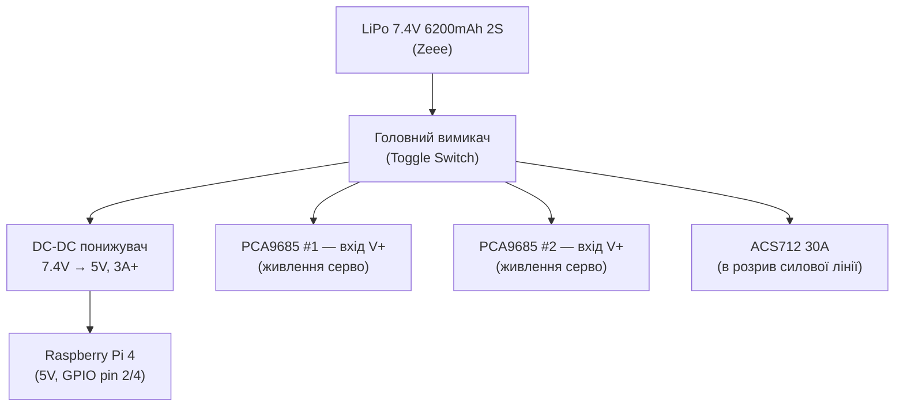
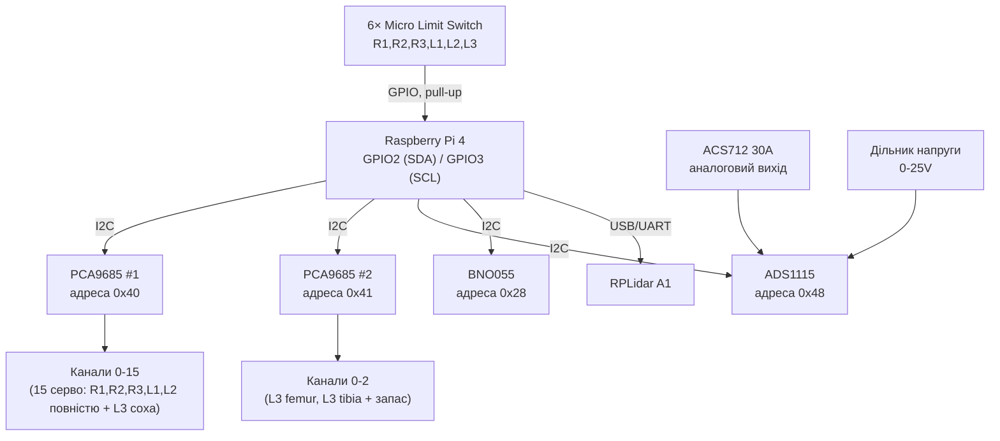

# Hexapod Robot

## 1. Огляд системи

Робот сам будує карту (SLAM), сам прокладає маршрут і обходить перешкоди (Nav2). Веб-панель: показує карту й позицію робота, дозволяє клікнути ціль. Вона нічим не керує напрямуб жодного джойстика, тільки постановка цілі.

Рівні системи:

1. **Живлення** — LiPo 2S батарея живить окремо серво (напряму) і Pi (через понижувач напруги).
2. **Апаратний рівень** — Raspberry Pi 4 керує двома PCA9685 (18 серво), читає ADS1115 (струм/напруга), кінцевики ходу (GPIO), LiDAR (SLAM/перешкоди) та IMU (орієнтація).
3. **ROS2-рівень** — SLAM, Nav2, генератор ходи, драйвер серво. Це основний і єдиний контур керування рухом.
4. **Веб-рівень** — тонкий клієнт над ROS2 через `rosbridge_server`: тільки карта + постановка цілі.

## 2. Схема живлення



**Важливо:**

- **Дві незалежні лінії живлення** від однієї батареї: одна напряму на V+ обох PCA9685 (живить лише серво), інша через понижувач на Pi. Так стрибки струму від серво під навантаженням не просаджують живлення Pi.
- PCA9685 має окремі піни **V+** (живлення серво, від батареї) і **VCC** (логіка, 3.3V від Pi) — не переплутати.
- **Спільна земля (GND)** обов'язкова між: батареєю, понижувачем, Pi, обома PCA9685, ADS1115, ACS712. Без спільного GND I2C і показники АЦП будуть "плавати".
- ACS712 стоїть **в розриві** силового проводу від вимикача до серво-плат, щоб міряти сумарний струм споживання серво.

## 3. Схема сигналів (I2C + GPIO)



### Мапа I2C-адрес

| Пристрій     | Адреса | Як виставити                               |
| ------------ | ------ | ------------------------------------------ |
| PCA9685 #1   | `0x40` | за замовчуванням, перемички A0-A5 не паяти |
| PCA9685 #2   | `0x41` | запаяти перемичку A0                       |
| ADS1115      | `0x48` | за замовчуванням (ADDR → GND)              |
| BNO055 (IMU) | `0x28` | за замовчуванням (ADR → GND)               |

RPLidar A1 підключається окремо через USB (має власний перетворювач UART→USB), не займає I2C-шину.

### Мапа GPIO (кінцевики ходу)

| Нога | GPIO Pi 4 | Режим                             |
| ---- | --------- | --------------------------------- |
| R1   | GPIO5     | Input, pull-up, NO-контакт на GND |
| R2   | GPIO6     | Input, pull-up                    |
| R3   | GPIO13    | Input, pull-up                    |
| L1   | GPIO19    | Input, pull-up                    |
| L2   | GPIO26    | Input, pull-up                    |
| L3   | GPIO21    | Input, pull-up                    |

### Мапа каналів ADS1115

| Канал | Джерело         | Призначення                                        |
| ----- | --------------- | -------------------------------------------------- |
| A0    | ACS712          | струм споживання серво                             |
| A1    | Дільник напруги | напруга батареї (для захисту від переразряду LiPo) |
| A2    | вільний         | резерв (напр. під IMU в майбутньому)               |
| A3    | вільний         | резерв                                             |

> Розподіл каналів PCA9685 по конкретних ногах/суглобах — приклад. Підлаштуй під свою нумерацію ніг і напрямок обертання серво під час калібрування тестером.

## 4. Програмна архітектура (ROS2 — основний контур)

```
hexapod_ws/src/
├── hexapod_description/      # URDF/xacro, TF-дерево ніг
├── hexapod_hardware/         # нода: драйвер PCA9685 x2, публікує joint_states
├── hexapod_gait/              # нода: інверсна кінематика + генератор ходи, підписка на /cmd_vel
├── hexapod_sensors/           # драйвери LiDAR (rplidar_ros), IMU (BNO055), ADS1115, лімсвічі
├── hexapod_localization/      # robot_localization: leg-odometry + IMU (EKF) → /odom
├── hexapod_slam/               # slam_toolbox → /map
├── hexapod_navigation/         # nav2_bringup: costmap, planner, controller → /cmd_vel
└── hexapod_web_bridge/          # rosbridge_server config + статична веб-панель
```

**Пайплайн руху:** `LiDAR + IMU → robot_localization (/odom) + slam_toolbox (/map) → Nav2 (планування, обхід перешкод) → /cmd_vel → hexapod_gait (кути 18 суглобів) → hexapod_hardware (PCA9685) → серво`.

Це повністю автономний контур — Nav2 сам вирішує, куди й як їхати, обходячи перешкоди по карті з LiDAR. Ходу (трипод-хода) `hexapod_gait` рахує на основі лінійної/кутової швидкості з `/cmd_vel`, так само, як робив би колісний робот — різниця лише в тому, що на виході не швидкість коліс, а кути суглобів ніг.

## 5. Веб-панель — тільки карта і ціль

Веб-панель **не керує рухом напряму**. Її єдині функції:

1. Показати карту (`/map`, `nav_msgs/OccupancyGrid`) і поточну позицію робота (`/amcl_pose` або TF).
2. Дати клікнути точку на карті → надіслати ціль (`geometry_msgs/PoseStamped` на `/goal_pose`, або виклик Nav2-екшену `navigate_to_pose`).

Реалізація — `rosbridge_suite` (пакет `rosbridge_server`) відкриває WebSocket-міст між ROS2-топіками і браузером; фронтенд на `roslibjs` підписується на `/map` і `/amcl_pose`, малює карту на `<canvas>`, і публікує ціль по кліку. Ніякого прямого доступу до серво чи `cmd_vel` з браузера немає — усе рішення "як їхати" ухвалює Nav2.

```
hexapod_web_bridge/
├── launch/rosbridge.launch.py   # запуск rosbridge_server (порт 9090)
└── static/
    ├── index.html                 # canvas з картою
    └── map_client.js               # roslibjs: підписка /map, /amcl_pose, публікація /goal_pose
```

## 6. Порядок збірки та калібрування

1. Спаяти силову частину (вимикач, Deans-роз'єм, ACS712 у розрив) — паяльник + термофен.
2. Перевірити напругу на виході понижувача (**рівно 5V**) до підключення Pi.
3. Прошити microSD (Raspberry Pi OS), увімкнути I2C (`raspi-config`).
4. Підключити обидва PCA9685 і ADS1115, перевірити адреси командою `i2cdetect -y 1` — мають з'явитись `0x40`, `0x41`, `0x48`.
5. По черзі відкалібрувати кожне з 18 серво тестером ACOSUN, позначити нейтральне положення маркером.
6. Змонтувати ноги, вклеїти дюбелі-обмежувачі суперклеєм, встановити лімсвічі в надруковані micro-switch-tip, підключити LiDAR (USB) і IMU (I2C).
7. Запустити `hexapod_hardware` і `hexapod_gait` окремо (без Nav2), перевірити телеметрію і ходу на піднятому над підлогою корпусі — це найпростіший спосіб зловити помилки калібрування до того, як у справу втрутиться автономна навігація.
8. Запустити повний launch (`hexapod_localization` + `hexapod_slam` + `hexapod_navigation` + `hexapod_web_bridge`), перевірити карту у веб-панелі, поставити першу тестову ціль на невеликій відстані у відкритому просторі.
9. Поступово ускладнювати сценарій — додавати перешкоди, перевіряти обхід через Nav2 costmap.
